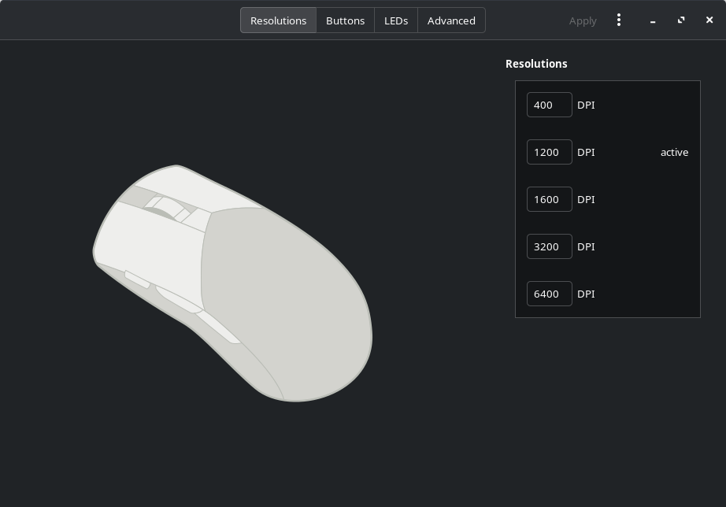
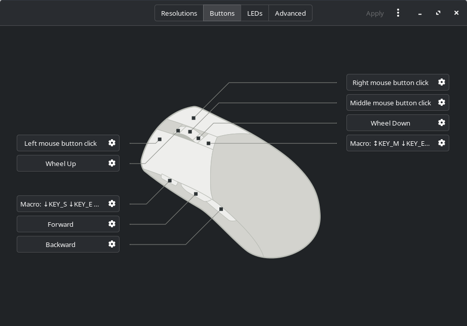
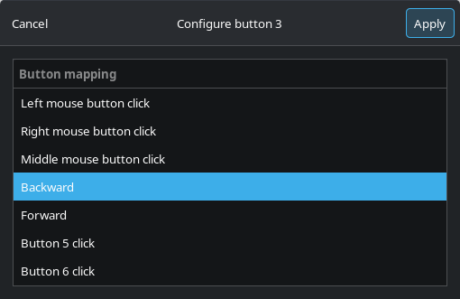
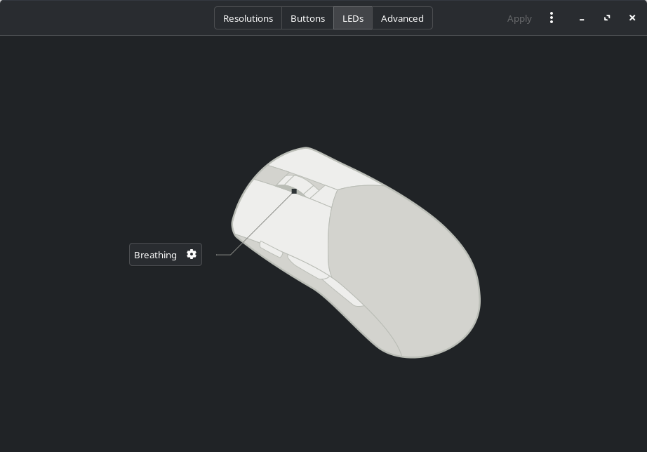

RPiper
======

RPiper is a fork of [Piper](https://github.com/libratbag/piper), the GTK+
application to configure gaming mice. It adds native support for Razer mice
that needs neither [OpenRazer](https://openrazer.github.io/) nor any kernel
module: RPiper talks to the mouse directly over hidraw, with no root daemon.
All other mice work as in Piper, through the ratbagd DBus daemon, see [the
libratbag
README](https://github.com/libratbag/libratbag/blob/master/README.md#running-ratbagd-as-dbus-activated-systemd-service)
for instructions on how to run ratbagd.

The Razer mouse supported so far is the Razer Basilisk V3 X HyperSpeed (USB
1532:00b9).

> **Note:** RPiper's Razer support has only been tested with the Razer
> Basilisk V3 X HyperSpeed (1532:00b9). It has not been tested with any other
> Razer mouse. Adding other models is probably easy: they use the same
> protocol family, and what differs is mainly the button ids, the DPI limits
> and the LED zones. Forking is straightforward, and pull requests are
> welcome.

What is working
---------------

Confirmed on the Razer Basilisk V3 X HyperSpeed:

- Remapping of all 9 buttons, including the extra side (thumb) button and the
  DPI button. A button can be disabled or set to a left, right, middle, back
  or forward click, scroll up/down, DPI up/down/cycle, double click or
  HyperShift.
- Keyboard keys and key combinations. Single keys and media keys (mute,
  volume up/down, play/pause, next, previous, stop) are stored on the mouse;
  key combinations are replayed like macros.
- Macros. The mouse has no macro memory: a button with a macro sends a spare
  code, and a small user service (`rpiper-razer-macros.service`) replays the
  macro. RPiper enables and starts the service when a macro is applied.
- Editing the 5 DPI stages (100 to 18000 DPI in steps of 50), disabling
  stages and switching the active DPI stage.
- Report rate: 125, 500 or 1000 Hz.
- Scroll-wheel LED: solid colour, colour cycle, breathing (one colour) and
  off, plus brightness.

Not supported (yet)
-------------------

- The HyperShift (second) layer: a button can be set to HyperShift, but the
  mappings of the second layer cannot be edited.
- LED effects other than the four modes above (no wave, reactive or
  dual-colour breathing). The effect speed is fixed.
- Storing macros on the mouse, which has no macro memory: macros only work
  while the user service is running.
- Hotplug: restart RPiper after re-plugging the USB receiver, or if the mouse
  was asleep when RPiper started.
- Battery and idle (sleep) settings are not exposed.

Installing RPiper
-----------------

Runtime dependencies: gtk3, python-gobject, python-evdev, python-lxml,
python-cairo and librsvg; libratbag is optional and only needed for non-Razer
mice. RPiper installs side by side with the distribution's `piper` package.

On Arch Linux and derivatives, build and install the package from this checkout
(uncommitted changes included), re-plug the mouse's USB receiver once
(pacman's udev hook already applies the new rules), then start the app:

```sh
cd packaging/arch && makepkg -si
rpiper
```

On other distributions, use meson directly, then reload and apply the udev
rules (or reboot):

```sh
meson setup builddir --prefix=/usr && meson compile -C builddir
sudo meson install -C builddir
sudo udevadm control --reload && sudo udevadm trigger
```

The udev rules give the logged-in user access to this mouse's hidraw nodes and
to /dev/uinput (needed to replay macros). The app enables and starts the macro
service when a macro is applied; this command does the same manually:

```sh
systemctl --user enable --now rpiper-razer-macros.service
```

Programs that grab input devices do not interfere, because the macro service
reads the mouse's raw HID reports. OpenRazer is not needed. Do not run its
daemon at the same time: both would talk to the mouse over the same control
channel.

If you are running RPiper from git with a non-Razer mouse, we recommend using
libratbag from git as well to make sure the latest bugfixes are applied.

Supported Devices
=================
Piper is merely a frontend, the list of supported devices depends on
libratbag. See [the libratbag device
files](https://github.com/libratbag/libratbag/tree/master/data/devices) for
a list of all known devices.  The device-specific protocols usually have to
be reverse-engineered and the features available may vary to the
manufacturer's advertized features. In addition, RPiper supports the Razer
Basilisk V3 X HyperSpeed directly, see [What is working](#what-is-working).

Screenshots
===========









And if you see the mousetrap, something isn't right. Usually this means that
either ratbagd is not running (like in this screenshot from upstream Piper),
ratbagd needs to be updated to a newer version, or some other unexpected error
occured.


Installing Piper
================

To install RPiper, see [Installing RPiper](#installing-rpiper) above. See [our
Wiki](https://github.com/libratbag/piper/wiki/Installation) for how to install
upstream Piper.

Building Piper from git
=======================

Piper uses the [meson build system](http://mesonbuild.com/). Run the following
commands to clone RPiper and initialize the build:

```sh
git clone https://github.com/ErenEksen/RPiper.git
cd RPiper
meson setup builddir --prefix=/usr/
```

To build or re-build after code-changes and install, run:

```sh
ninja -C builddir
sudo ninja -C builddir install
```

Note: `builddir` is the build output directory and can be changed to any other
directory name.

See [our Wiki](https://github.com/libratbag/piper/wiki/Installation) for what
to do when you encounter missing dependencies.

Contributing
============

Yes please. It's best to contact us first to see what you could do. Note that
the devices displayed by Piper come from libratbag.

For quicker development iteration, there is a special binary `rpiper.devel`
that uses data files from the git directory. This removes the need to
install rpiper after every code change.

```sh
ninja -C builddir
./builddir/rpiper.devel
```
Note that this still requires ratbagd to run on the system bus for non-Razer
mice.

Piper tries to conform to Python's PEP8 style guide using the `black` formatter.
Checking if code is formatted is done as a part of the test suite.

You can check if your code passes tests before submitting changes using the
following command:

```sh
meson test -C builddir
```

Source
======

```sh
git clone https://github.com/ErenEksen/RPiper.git
```

Bugs
====

Bugs in RPiper and its Razer support can be reported in the issue tracker on
our GitHub repo: https://github.com/ErenEksen/RPiper/issues

Bugs in upstream Piper can be reported in the issue tracker on its GitHub
repo: https://github.com/libratbag/piper/issues

License
=======

Licensed under the GPLv2. See the [COPYING](COPYING) file for the full license
information.
